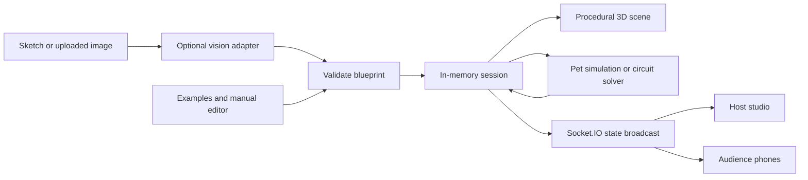

# Living Paper

**Turn a sketch into a world you can test.**

Living Paper is a small creation studio for editable virtual pets and simple circuits. Draw directly in the browser, start from an example, or edit the parts by hand; build an interactive 3D scene; then let an audience change the same world from their phones.

The important step is the **validated Design Blueprint** between the idea and the scene. The renderer, interactions and blueprint files all use that specification. Pets are assembled from preset 3D parts; circuits use a deterministic series DC calculation. This build does not generate arbitrary meshes or CAD files.

The current demo uses **clearly labelled example mode, with no API key required**. Its 3D rendering, editors, pet simulation, circuit calculation and audience synchronisation run locally. Live sketch interpretation, AI decisions and portrait generation are separate, optional integrations; see [AI and example mode](#ai-and-example-mode).

## Run it

Requires Node.js 20 or later and npm. Node.js 22 is used in CI.

```bash
npm ci
npm run dev
```

Open the [host studio](http://localhost:5173) and the [audience page](http://localhost:5173/join). Both the UI and API use port 5173. With no `.env` or key, the server starts in example mode.

For the quickest first creation, choose **Pet**, press **Try example**, edit its name or parts, and press **Build in 3D**. The audience page can then Feed, Pet and Play. Choose **Circuit** to build a battery–switch–resistor–LED loop and flip the switch.

For a production build:

```bash
npm run build
npm start
```

The app needs its Node server for API routes and Socket.IO; the generated client files alone are not the full application.

For your teammate's API key and a public demo, follow the [deployment guide](docs/DEPLOYMENT.md). The current shared, in-memory server needs additional state and realtime coordination before it can be described as ready for a multi-instance Vercel deployment.

## What you can make

| Mode | Editable blueprint | Live behaviour |
| --- | --- | --- |
| Pet | Name, body shape, colours, one to three eyes, ears, legs, tail, mouth and simple extras | Hunger, happiness and energy change over time and through interactions; the pet animates its current action |
| Circuit | Battery, resistor, LED, bulb and switch components, values, positions and wires | Open/closed loop detection, switch control, calculated current, LED state and warnings |

The supported circuit is one series loop. Its main calculation is `I = (total battery voltage − total LED forward voltage) / total resistance`. It is an educational approximation, with default values when a component has no explicit value. It does not simulate arbitrary circuit networks or real electronic failure.

The drawing pad supports pen, eraser, undo and clear. **Read this sketch** sends a real PNG through the same recognition path as an upload; **Save PNG** downloads the drawing itself. Uploads accept PNG, JPEG or WebP images up to 8 MB. Live interpretation needs a server key; its result is editable before building, and unclear details are shown to the host. Without a key, image reading explains that it is unavailable and the editable examples remain usable.

**Save blueprint** downloads the confirmed creation as a JSON specification. **Open blueprint** validates an imported file before rebuilding through the normal creation API. This preserves the design, not the pet's interaction history or a generated mesh. Use the starter pets Pixel, Mochi or Orbit for a quick alternative design.

The host can Feed, Pet and Play directly from the live readout. **Present** enlarges the stage for a demo; **Back to studio** or Escape restores the full editor.

See the [two-minute demo and rehearsal checklist](docs/DEMO.md), [submission copy](docs/SUBMISSION.md), and [verification record](docs/VERIFICATION.md).

## AI and example mode

| Feature | With configured credentials | Without credentials |
| --- | --- | --- |
| Sketch interpretation | The server adapter sends the image to the Responses API with a structured pet/circuit schema, then validates the output | Built-in examples and manual editing remain available; no image analysis is claimed |
| Ask the pet | The Decisions API chooses from allowed actions using the pet's current needs and recent interactions; application code validates and applies the choice | A deterministic rule chooses an action, visibly labelled as an example |
| Pet portrait | The image adapter requests a 2D portrait, displayed on a stand | The procedural 3D pet remains available |

The portrait is a picture, not a generated 3D mesh. A configured key means an integration is **Ready**; the status becomes **Live** only after a successful request. Failures are shown rather than presented as AI success.

**Live OpenAI calls have not been verified from this checkout.** A key on a teammate's machine still needs a live smoke check and separate deployment configuration; see the [deployment guide](docs/DEPLOYMENT.md). Automated API tests inject controlled responses; they establish application behaviour, not live model access or quality. The local demo does not require those calls.

To enable the integrations, copy `.env.example` to `.env` and set credentials on the server only:

```bash
cp .env.example .env
```

| Variable | Repository default | Purpose |
| --- | --- | --- |
| `OPENAI_API_KEY` | Unset | Enables live adapters; the sample placeholder is treated as unset |
| `OPENAI_VISION_MODEL` | `gpt-6-astra` | Configured model ID for image interpretation |
| `OPENAI_DECISIONS_MODEL` | `gpt-6-luna` | Configured model ID for pet decisions |
| `OPENAI_IMAGE_MODEL` | `gpt-image-2.5-flare` | Configured model ID for optional portraits |
| `OPENAI_BASE_URL` | `https://api.openai.com/v1` | Optional API base URL override |
| `HOST` / `PORT` | `0.0.0.0` / `5173` | Server bind address and port |
| `PUBLIC_BASE_URL` | Unset | Reachable origin used in the audience QR code |

These are the repository's configured IDs, not a claim that every account can access them. Change the matching setting if the API reports an unavailable model. Never commit `.env` or a real key.

Run the optional live smoke check only after configuring credentials:

```bash
npm run smoke:live
```

It makes real vision and decision requests. `npm run smoke:live -- --image` also requests a billed image. With no key, the script reports that live calls were not verified.

## Audience phones

Phones need an address they can reach; `localhost` points to the phone itself. Set `PUBLIC_BASE_URL` to this computer's LAN origin on the same Wi-Fi, or to an existing reachable HTTPS tunnel, then restart the server. For example:

```dotenv
PUBLIC_BASE_URL=http://192.168.1.20:5173
```

Use your computer's actual address. Wi-Fi client isolation can prevent this connection. The audience QR code points to `/join`; host and guest updates are broadcast over Socket.IO. A second browser tab at `/join` is useful for a local rehearsal. Camera capture generally needs HTTPS or localhost; choosing an existing image file remains available.

## Architecture



| Location | Responsibility |
| --- | --- |
| `shared/` | TypeScript contracts, blueprint types and validation |
| `server/` | Express API, in-memory session, bounded interactions, simulations and OpenAI adapters |
| `src/host/` | Creation editors, stage controls, readouts and audience link |
| `src/guest/` | Phone interaction page |
| `src/scene/` | React Three Fiber scene and preset pet/circuit geometry |
| `tests/` | Vitest unit/API tests and Playwright desktop/mobile flows |

The primary routes are `GET /api/health`, `GET /api/state`, `POST /api/creation`, `POST /api/interactions`, `POST /api/vision/analyze?mode=pet|circuit`, `POST /api/bean/ask`, `POST /api/bean/image`, and `GET /api/bean/image.png`. All mutations use REST; Socket.IO broadcasts state. Legacy queue-simulation routes remain in the repository but are outside this pet/circuit demo.

## Verify it

```bash
npm run typecheck
npm test
npm run build
npx playwright install chromium
npm run test:e2e
```

Playwright starts its own server on port 4599 with `OPENAI_API_KEY` explicitly empty. It runs Chromium desktop and mobile viewport projects; traces and screenshots are retained on failure. CI installs browser system dependencies and runs the same checks. Final command results and remaining verification gaps are recorded in [docs/VERIFICATION.md](docs/VERIFICATION.md).

## Limits and troubleshooting

- One shared, in-memory session exists per server process. Refreshing the browser reconnects to it; restarting the server clears it. There are no accounts or private rooms. Download a blueprint to retain a design across restarts.
- This is a hackathon demo for a trusted audience. Host mutation routes are not authenticated; anyone who can reach the server can change the shared creation.
- WebGL is required for the 3D scene. When it is unavailable, the app displays a fallback while readouts and controls remain useful.
- API errors such as invalid credentials, model access, timeouts and rejected outputs appear in the status/readout UI. No API key is sent to the browser.
- Supported output is JSON blueprints and sketch PNGs. CAD, STL/GLB export, arbitrary 3D reconstruction, voice input and general web component generation are outside this build.

## Built with and credits

React, TypeScript, Three.js, React Three Fiber, Drei, Vite, Express, Socket.IO, Zod and qrcode power the application. Vitest, Supertest, Testing Library and Playwright support verification. OpenAI adapters provide the optional live integrations. See `package.json` and `package-lock.json` for the exact dependency set.

The repository already contained the pet/circuit studio, procedural renderers, examples, simulation and API adapters before the final demo preparation. Codex assisted with source inspection, implementation, reliability fixes, tests, documentation and demo preparation; concrete contributions and scope are described in [docs/SUBMISSION.md](docs/SUBMISSION.md). No third-party asset ownership or team attribution is implied beyond what is documented there.
